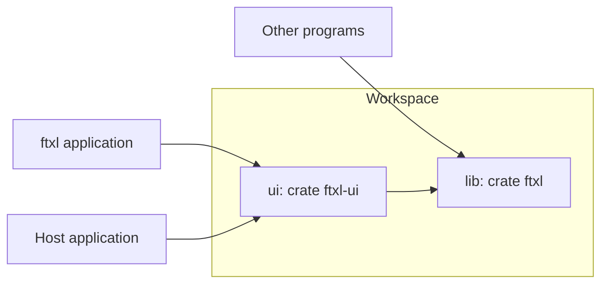
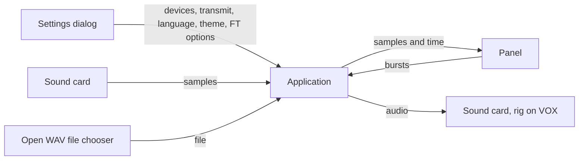
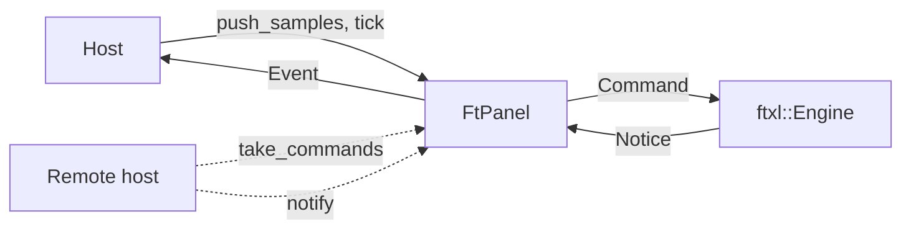
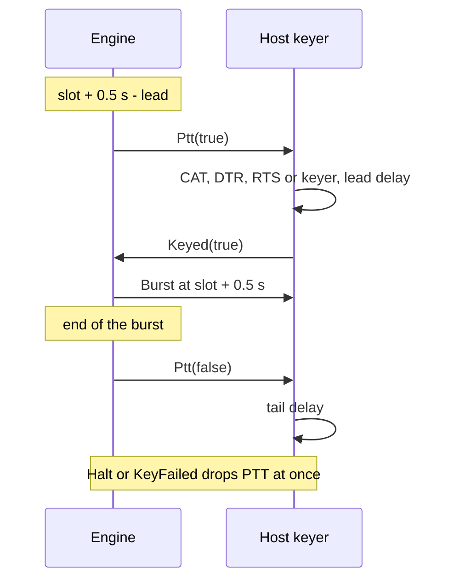
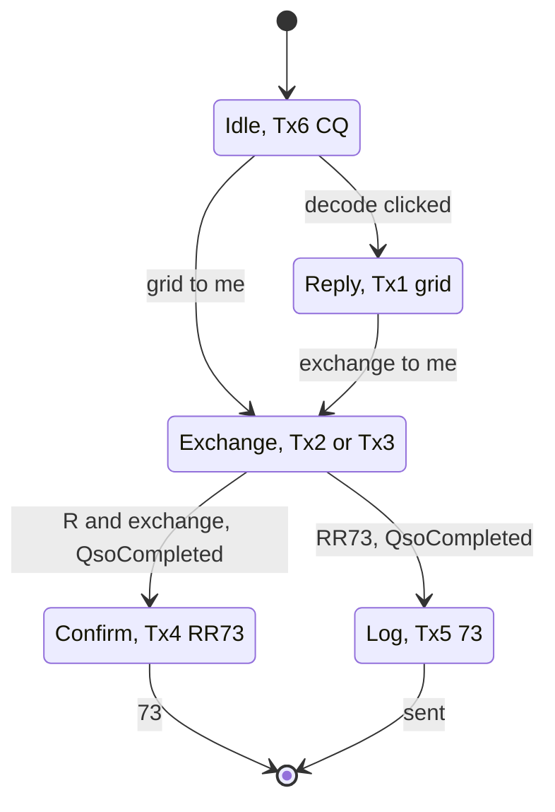
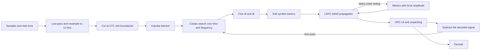
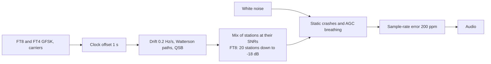
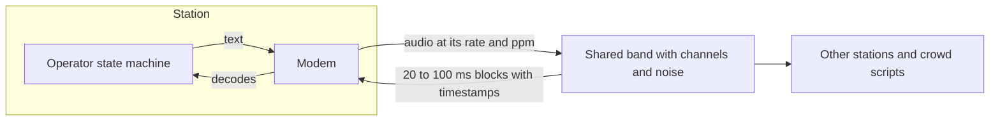

# FTxL


FTxL is a Rust library for FT8 and FT4, with an HF band simulator to test and tune it.
It comes with an egui panel, a QSO sequencer and an application.

## Workspace



| Directory | Crate | Role |
|---|---|---|
| `lib` | `ftxl` | Modems, sequencer, engine, simulator and bench, pure Rust without I/O. |
| `ui` | `ftxl-ui` | FT panel and the `ftxl` application (feature `app`). |

## Get Started

```toml
[dependencies]
ftxl = { git = "https://github.com/nextzlog/ftxl" }
```

```rust
use ftxl::{Ft8, Modem, Options};
use std::time::SystemTime;

let mut modem: Box<dyn Modem> = Box::new(Ft8::new(48000, Options::default())?);
let samples = vec![0.0; 960];
for d in modem.push(&samples, SystemTime::now()) {
    println!("{:?} {:+.0} dB {:?} {:.0} Hz {}", d.slot, d.snr, d.dt, d.hz, d.text);
}
let tx = modem.transmit("CQ JA1ZLO PM95", 1500.0, SystemTime::now())?;
println!("{} samples at {:?}", tx.audio.len(), tx.start);
Ok::<(), String>(())
```

## Build

```sh
$ cargo build --release -p ftxl-ui
$ ./target/release/ftxl
$ cargo test --workspace
```

## Application



```text
+--------------------------------------------------------------+
| ▶ Start  🗁 Open…  FT8 FT4  Even Odd  Enable Tx  Halt  ⚙ Settings |
+--------------------------------------------------------------+
| 12:34:45 Odd  Clock +1.2 s  ▮▮▮▮▮▯▯▯▯▯                          |
| UTC     dB   DT   Hz Message                                  |
| decode list                                                   |
+--------------------------------------------------------------+
| band strip, Rx and Tx                                         |
| DX [Call                ] Reply                               |
| ( ) Tx1 ... ( ) Tx6                                           |
+--------------------------------------------------------------+
```

| Setting | Choice |
|---|---|
| Input, Output | Default device or a sound card |
| Transmit | Off, or VOX |
| Language | English or 日本語 |
| Theme | System, Light or Dark |
| FT8 / FT4 | My call and grid, CQ, exchange, DX grid, report, band edges, decoding |

The clock row shows the UTC time, the parity and the progress of the current slot.
A clock skew over 0.5 s and a decode slower than a tenth of the slot show as warnings with tooltips.
CAT is left to host applications.

## Panel and Engine

The panel never touches the modem.
It sends a `Command` to an `Engine` and shows the `Notice`s that come back, so a host may run the engine on another machine.



| Command | Meaning |
|---|---|
| `Start`, `Stop`, `Halt` | Receive, stop, abort the transmission. |
| `Setup` | Mode, Rx and Tx, parity, options and the sequencer. |
| `Select` | A clicked decode, which picks the station. |
| `Samples` | Audio with its rate and start time. |
| `OutputRate` | Sample rate of the audio output. |
| `Tick` | The current time, which sends in the slot. |
| `PttLead` | The PTT lead of a host keyer, or `None` without one. |
| `Keyed`, `KeyFailed` | The host keyer confirms keying, or reports a failure. |
| `Dial` | The dial frequency in Hz, stamped on spots and contacts. |

| Notice | Meaning |
|---|---|
| `Running` | Receiving started or stopped. |
| `Setup` | The engine changed the setup, such as the next message. |
| `Decode`, `Spot` | A message, and the station it came from. |
| `Pick`, `QsoCompleted` | A picked station, and a contact to log. |
| `Burst`, `Halt`, `Ptt` | Audio to play, stop the audio, key the transmitter. |
| `Tune` | The dial frequency wanted, after a switch between FT8 and FT4. |
| `Warnings` | Clock skew and decode latency. |
| `Error` | A message for the status line. |

## Keying



PTT is asked for the lead before the audio, or 0.6 s before it when the lead is shorter.
The burst always starts at the slot start plus 0.5 s.
A slot whose keying is not confirmed by then is skipped with PTT off and an error, and the next slot of the parity is tried.
`KeyFailed` halts the sequencer.
Without `PttLead`, the engine confirms itself and sends the burst with `Ptt(true)`, as the standalone application does on VOX.
`Tune` maps the standard dial frequencies of FT8 and FT4 on each band, and the host answers with `Dial`.

`FtPanel::new` holds its own engine.
`FtPanel::remote` holds none, and the host carries `take_commands` to the engine and its notices back to `notify`.

| Item | Role |
|---|---|
| `FtPanel` | Toolbar, slot clock, decode list, band strip, DX call and Tx1 to Tx6. |
| `toolbar`, `body`, `ui`, `tools_ui`, `toolbar_ui` | The toolbar row, the rest, or both, with host items after Open WAV. |
| `settings_ui`, `settings`, `load_setting` | Panel options and their key and value pairs. |
| `set_ptt_lead`, `keyed`, `key_failed`, `set_dial` | The host keyer and the dial. |
| `seq.cq`, `seq.exchange` | The CQ call and the exchange format from the host. |
| `FtTools` | Toolbar items a host hides. |
| `Clock`, `wav` | Times of sound-card blocks, and WAV files. |

| Event | Fields | Meaning |
|---|---|---|
| `Running` | bool | Receiving started or stopped. |
| `Decode` | `ftxl::Decode` | A message. |
| `Spot` | mode, callsign, grid, snr, hz, dial_hz, at | A heard station. |
| `Pick` | callsign, grid, hz | A clicked decode. |
| `QsoCompleted` | mode, callsign, grid, sent, rcvd, hz, dial_hz, at | A contact completed by the sequencer. |
| `Burst`, `Halt`, `Ptt` | | Audio, stop, key. |
| `Tune` | dial in Hz | The dial frequency wanted. |
| `Warnings` | list | Clock skew and decode latency. |
| `OpenWav`, `Settings` | | The host opens a file or its settings. |

The icons are the Phosphor font in `ui/data`, drawn by `ftxl_ui::icon`.
The toolbar wraps down to 280 px, and the panel fills a tall narrow dock.

## Sequencer



The exchange is a format from the host, `$R` for the report and `$G` for my grid, so `$G` gives the contest messages `R PM95`.
A clicked decode also sets Rx to its frequency and Tx to the other slot.
The burst goes out 0.5 s into the slot, and a slot missed by more than 1 s waits for the next.

## Receiving



| Decode | Meaning |
|---|---|
| slot | UTC start of the slot |
| at | End of the slot |
| snr | SNR in 2500 Hz |
| hz | Frequency of tone 0 |
| dt | Offset from the nominal 0.5 s |
| fields | Addressee, sender and exchange |

Standard messages, grids, reports, RRR, RR73, 73 and free text are supported.
Hashed and non-standard callsigns and the contest message types are not supported yet.
Any sample rate from 8 kHz up is accepted, block sizes are free, and timestamps may jitter by up to 20 ms.

## Simulator



| Item | FT8 | FT4 |
|---|---|---|
| Slot | 15 s | 7.5 s |
| Tones | 8, 6.25 Hz apart | 4, 20.8 Hz apart |
| Decode time | 200 ms per slot, 440 ms with 20 stations | 250 ms per slot, 450 ms with 20 stations |
| All decoded in white noise | -18 dB | -12 dB |
| Crowded slot of 20 stations | 99 % at -18 dB | 97 % at -14 dB |
| False decodes on an empty band | 0 per hour | 0 per hour |

| Channel | FT8 | FT4 |
|---|---|---|
| awgn | -18 / -18 dB | -14 / -14 dB |
| static crashes | -8 / -18 dB | none / -14 dB |
| mid-quiet | -16 / -16 dB | -14 / -14 dB |
| mid-moderate | -16 / -16 dB | -12 / -12 dB |
| mid-disturbed | -16 / -16 dB | -12 / -12 dB |
| low-moderate | -16 / -16 dB | -12 / -12 dB |
| low-disturbed | none | -10 / -10 dB |
| high-moderate | none | -10 / -10 dB |
| high-disturbed | none | none |
| flutter | none | -4 / -4 dB |

Each column is the lowest SNR in 2500 Hz where half the signals decode, without and with the blanker and the fading metric.

```sh
$ cargo run --release -p ftxl --example bench -- ft8 mid-moderate 20
$ cargo run --release -p ftxl --example bench -- ft4 silence 30
```

## QSO Tests



The scenarios cover full FT8 and FT4 contacts, an FT4 contest, a crowded band, a pile-up, weak signals, fading, drift, clock offsets, lost messages and the hour boundary.

## From rtty

| rtty 0.1 | FTxL |
|---|---|
| `rtty::{Ft8, Ft4, Modem, Options, Decode, Parity, pack, unpack, fields}` | `ftxl::` with the same names |
| `Options.rtty`, `RttyOptions`, `Decode.unit`, `Unit` | removed |
| `rtty_ui::{FtPanel, FtTools}` | `ftxl_ui::` with the same names |
| `rtty_ui::Proto`, `Mode` | `ftxl::Proto`, with `name` |
| `rtty_ui::{Burst, Pick, Qso, Sequencer}`, `ft::next_slot`, `ft::slot_start` | `ftxl::` |
| `Qso.sent`, `Qso.rcvd`, `Contact.sent`, `Contact.rcvd` | `String`, the exchange as sent and received |
| `Event::{Heard, Number, Message}` | removed, with `Spot` and `Warnings` added |
| `sim::Source::Rtty`, `rtty_trial`, `words`, `edit_distance` | removed |

## License

### Author

- JG1VPP
- JS2FVO

### Clauses

- This library is released under the [MIT License](LICENSE).
- The Phosphor Icons is under the [MIT License](ui/data/LICENSE).
- The LDPC tables in `lib/src/tables.rs` are taken from [ft8_lib](https://github.com/kgoba/ft8_lib) by Kārlis Goba, also under the MIT License.
